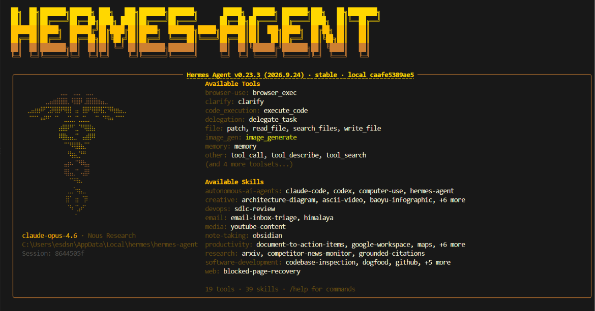

# GuardAI: Agente inteligente para Cibersegurança e vulnerabilidades

Desafio Final **Santander Bootcamp Cybersegurança do zero à prática**.
Tranformando o DIO Agent em um mentor de Cibersegurança.

## Preparando o Ambiente

O Ponto de partida é o **DIO Agent**, um agente de IA criado pela DIO para auxiliar nos estudos. O objetivo é fazê-lo evoluir para um agente especialista em Cibersegurança.
O repositório base pode ser consultado [aqui](https://github.com/digitalinnovationone/dio-agent "DIO Agent").

O ambiente (Harness) escolhido para rodar o DIO Agent foi o [Hermes](https://hermes-agent.nousresearch.com/docs "Hermes Agent").

### Testando o Hermes

Escrevi um pequeno [programa em python](/agent/app.py) que demonstrava o recurso de acesso por login e senha por meio do *sqlite3* com uma vulnerabilidade proposital e pedi ao Hermes para avaliar:

**Prompt:** Avalie o código do arquivo app.py e como especialista em cybersecurity, encontre a falha, explique a exploração, cite a técnica do MITRE ATT&CK e reescreva o código.

***Hermes:***
*Encontrei e corrigi uma injeção SQL em C:\ ...\dio-agent\agent\app.py:5-10. A falha estava na montagem da consulta com uma f-string: os valores de usuário e senha eram inseridos diretamente no SQL. Um atacante poderia tentar usar como usuário ' OR 1=1 --  e uma senha qualquer. Isso altera a condição da consulta e pode permitir login sem conhecer uma senha válida. Reproduzi o bypass antes da correção em um banco SQLite temporário.Reescrevi a função para usar parâmetros SQL (?), consultar apenas a existência de um registro e fechar a conexão mesmo se houver erro. O teste após a correção aceitou a combinação válida e rejeitou tanto uma senha incorreta quanto o payload de injeção. Classificação: CWE-89 (SQL Injection). MITRE ATT&CK T1190 — Exploit Public-Facing Application, caso essa função esteja acessível por uma aplicação exposta a uma rede. O arquivo, que já estava não rastreado pelo Git antes da alteração, continua não rastreado; não fiz commit. Ponto pendente: a função compara a senha recebida diretamente com a coluna password. Se o banco armazena senhas em texto claro, migre para hashes com salt usando Argon2id, scrypt ou PBKDF2. O projeto não contém o esquema nem o fluxo de cadastro para confirmar ou corrigir essa parte sem presumir como os dados são criados.*

**Prompt:** O que é e o que faz esse "MITRE ATT&CK"?

***Hermes:***
*MITRE ATT&CK é uma base de conhecimento que organiza comportamentos usados por adversários em ataques reais. Ela ajuda equipes de segurança a descrever ameaças, planejar detecções e avaliar defesas. Não é uma ferramenta nem uma vulnerabilidade. A técnica T1190, “Exploit Public-Facing Application”, descreve a exploração de uma falha em uma aplicação acessível pela internet para obter acesso inicial. No exemplo anterior, essa classificação só se aplica se a função de login estiver exposta por uma aplicação pública. A falha em si é mais precisamente classificada como CWE-89: injeção SQL.*

Podemos constatar que esse Hermes é bem inteligente. Mas vamos torná-lo ainda melhor :wink:

---

# Evoluindo o DIO Agent

Para tonar o DIO Agent em um especialista em Cibersegurança e instruir o estudante de forma adequada, lhe atribuí novas habilidades e especifiquei seu comportamento, além de documentar os procedimentos nos arquivos README.

Foram criados:

- Uma nova [skill](/skills/vulnerability-analysis/SKILL.md) na pasta criada **skills/vulnerability-analysis/** para ensinar o agente sobre vulnerabilidades de segurança da informação e com intuito de fornecer uma abordagem defensiva e didádica aos alunos.

- Uma nova base de conhecimentos ao agente, roteirizado no arquivo [security-basics.md](/agent/knowledge/security-basics.md), na pasta ***agent/knowledge/***. A base em questão é justamente conhecimento dos fundamentos básicos em Cibersegurança, especificando o que é:
	- vulnerabilidade
	- ameaça
	- risco
	- confidencialidade
	- integridade
	- disponibilidade
	- boas práticas
	
- Um trecho na [persona](/agent/persona.md) em **agent/persona.md** para intruir o agente que além de mentor educacional ele possui conhecimento básico em Segurança da informação e tem por objetivo formar profissionais capazes de pensar como analistas de cyber-segurança.

- Uma atribuição de **Security Skills** em AGENTS.md intruindo-o a aplicar a skill em **vulnerability-analysis** quando ele for requisitado para respoder questões relacionadas à segurança.

# Resultado

O DIO Agent generalista evoluiu para o **GuardAI**. Assumindo a *persona* de um mentor com habilidades específicas dedicado a ensinar os alunos sobre segurança da informação e Cibersegurança.

Surpreendentemente ainda é possível evoluir, atribuindo novas skills e especificando seu comportamento para torná-lo ainda mais preciso e coerente com as requisições relacionadas à area de Cibersegurança. Portanto, o projeto tem alto potencial de crescimento e evolução.
